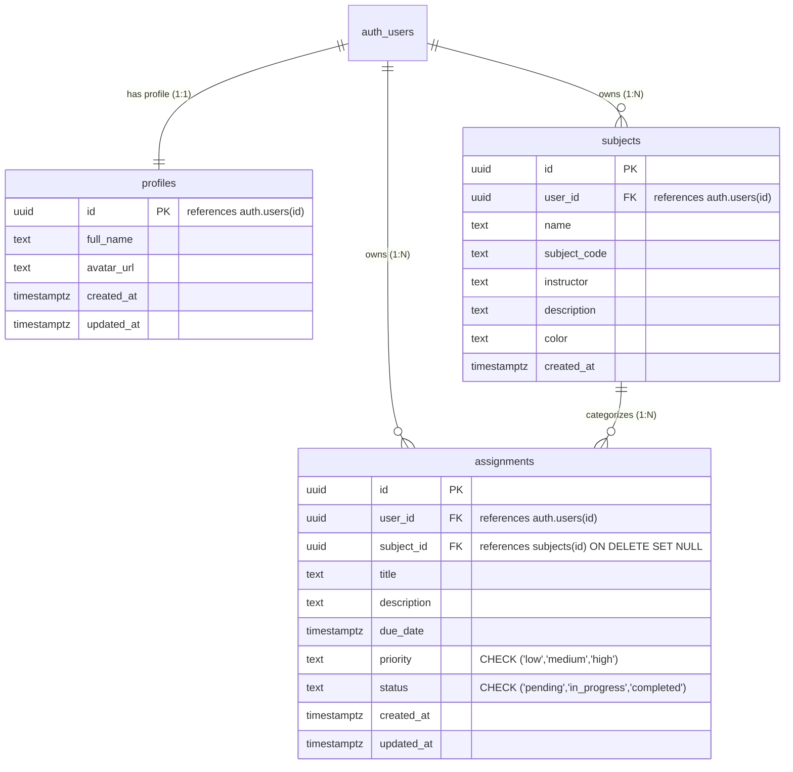

# 📚 StudyFlow — Student Productivity & Academic Management System

StudyFlow is a modern, responsive, full-stack student productivity platform designed to help students organize their academic coursework, track assignment deadlines, prioritize tasks, and manage their study schedules in one unified workspace.

Built with **React**, **TypeScript**, **Tailwind CSS**, and **Supabase (PostgreSQL + Auth)**, StudyFlow delivers an authentic SaaS application experience with complete database persistence, real-time statistics, and strict data security using PostgreSQL Row Level Security (RLS).

---

## 🌟 Key Features

### 🔐 Authentication System (Supabase Auth)
- **Email & Password Authentication**: Secure student sign-in with persistent sessions across page refreshes.
- **Student Registration**: Automated user profile initialization linked directly to `auth.users(id)`.
- **Password Recovery & Reset**: End-to-end forgot-password and reset-password recovery flows.
- **Route Protection**: Automated redirects for authenticated and unauthenticated routes.
- **User Data Isolation**: Each student only accesses their own private courses, tasks, and deadlines.

### 📊 Personalized Student Dashboard
- **Real-Time Dynamic Metrics**: Calculated directly from live database records:
  - Total Assignments
  - Pending & In-Progress Tasks
  - Completed Assignments & Overall Completion Percentage
  - Overdue Assignments (auto-flagged based on UTC deadlines)
- **Weekly Productivity Analytics**: Visualizes completed vs. pending tasks per day of the current week using **Recharts**.
- **Tasks Due Today**: Immediate access to today's deadlines with instant completion checkboxes.
- **Upcoming Deadlines**: Relative countdown badges (e.g. *Due Today*, *Due Tomorrow*, *Due in 3 days*).
- **Recent Academic Activity**: Audit feed of recent task creations and completions.
- **Global Quick-Add**: "+ Add Assignment" modal accessible from anywhere in the interface.

### 📝 Task & Assignment Management
- **Full CRUD Operations**: Create, view, edit, and delete assignments with confirmation prompts.
- **Detailed Attributes**: Title, rich description, associated subject, due date & time, priority (*Low*, *Medium*, *High*), and status (*Pending*, *In Progress*, *Completed*).
- **Filtering & Search**:
  - Filter by status (*All*, *Pending*, *In Progress*, *Completed*)
  - Filter by priority (*All*, *Low*, *Medium*, *High*)
  - Filter by subject / course
  - Real-time case-insensitive search by title
- **Sorting**: Sort by due date (earliest or latest) or date created.
- **Dual Display Modes**: Toggle seamlessly between responsive Card Grid view and Data Table view.

### 🎨 Subject & Course Management
- **Course Organization**: Organize assignments by academic courses (e.g., Computer Science, Calculus, Organic Chemistry).
- **Metadata**: Course code, instructor name, lecture notes / syllabus description, and custom color swatches.
- **Progress Tracking**: Automatic calculation of assignment count and completion rate per subject.
- **Safe Deletion Protocol**: Prevents accidental data loss by warning students and offering an option to safely unlink assignments.

### 📅 Interactive Academic Calendar
- **Monthly Calendar View**: Full monthly grid display with colored subject chips, day navigation, and jump to "Today".
- **Weekly Schedule View**: 7-day column agenda layout with deadline times.
- **Interactive Event Modal**: Click any calendar event to view full details, toggle completion status, or edit.

### 📋 Kanban Task Planner
- **Workflow Lanes**:
  - **Due Today & Overdue** (Immediate focus)
  - **Upcoming (Next 7 Days)** (Coursework on deck)
  - **Later & In Progress** (Ongoing and upcoming projects)
  - **Completed** (Finished milestones)
- **Quick Status Transitions**: Single-click actions to advance tasks to in-progress, complete them, or reopen them.

### ⚙️ Profile & Settings
- Editable student profile name saved to Supabase `profiles` table.
- Display of registered email and account creation timestamp.
- Interface theme preferences (Light / Dark / System).
- Backend connection health monitor and secure session termination (Logout).

---

## 🛠️ Technology Stack

| Layer | Technologies |
|---|---|
| **Frontend Framework** | [React 18](https://react.dev/) with [Vite](https://vitejs.dev/) |
| **Language** | [TypeScript](https://www.typescriptlang.org/) (Strict typing throughout) |
| **Styling & UI** | [Tailwind CSS](https://tailwindcss.com/) with custom design system |
| **Icons** | [Lucide React](https://lucide.dev/) |
| **Backend & Database**| [Supabase](https://supabase.com/) (PostgreSQL 15 Engine) |
| **Authentication** | Supabase Auth (JWT, Session Persistence, Password Recovery) |
| **Form Validation** | [React Hook Form](https://react-hook-form.com/) + [Zod](https://zod.dev/) |
| **Charts & Analytics**| [Recharts](https://recharts.org/) |
| **Date Handling** | [date-fns](https://date-fns.org/) |
| **Routing** | [React Router v6](https://reactrouter.com/) |

---

## 🏗️ Application Architecture

```
studyflow/
├── public/
├── src/
│   ├── components/
│   │   ├── assignments/       # Assignment cards, tables, filters, forms, modals
│   │   ├── auth/              # Auth layout, ProtectedRoute, PublicOnlyRoute
│   │   ├── calendar/          # Monthly & weekly views, event detail modals
│   │   ├── common/            # Empty states, loading spinners, setup banner/modal
│   │   ├── dashboard/         # Metric cards, Recharts chart, today/upcoming widgets
│   │   ├── layout/            # Sidebar, TopNavbar, MobileNavigation, MainLayout
│   │   ├── planner/           # Kanban workflow columns & quick status actions
│   │   ├── subjects/          # Subject cards, subject form modal, safe delete modal
│   │   └── ui/                # Button, Input, Select, Textarea, Card, Badge, Modal, Toast
│   ├── contexts/
│   │   └── AuthContext.tsx    # Supabase user session, profile, and auth methods
│   ├── lib/
│   │   ├── supabase.ts        # Supabase client instantiation & config validation
│   │   └── utils.ts           # Styling (cn), date-fns helpers, color presets, badges
│   ├── pages/
│   │   ├── auth/              # LoginPage, RegisterPage, ForgotPassword, ResetPassword
│   │   ├── AssignmentsPage.tsx
│   │   ├── CalendarPage.tsx
│   │   ├── DashboardPage.tsx
│   │   ├── NotFoundPage.tsx
│   │   ├── PlannerPage.tsx
│   │   ├── ProfilePage.tsx
│   │   └── SubjectsPage.tsx
│   ├── services/              # Pure async API modules interfacing with Supabase
│   │   ├── assignmentService.ts
│   │   ├── authService.ts
│   │   ├── profileService.ts
│   │   └── subjectService.ts
│   ├── types/
│   │   └── database.ts        # Database entity models, filters, and helper types
│   ├── App.tsx                # Route definitions & context provider nesting
│   ├── index.css              # Tailwind base, utilities, and custom scrollbars
│   └── main.tsx               # Application mount point
├── supabase/
│   └── migrations/
│       └── 20250101000000_create_studyflow_schema.sql # Complete PostgreSQL DDL & RLS
├── .env.example
├── package.json
├── tailwind.config.js
├── tsconfig.json
└── vite.config.ts
```

---

## 🗄️ Database Schema & Relationships

The database is built on Supabase PostgreSQL. Below is the relational structure:



### Automatic Profile Creation Trigger
A PostgreSQL database trigger `on_auth_user_created` fires automatically whenever a new row is inserted into `auth.users`:
```sql
CREATE OR REPLACE FUNCTION public.handle_new_user()
RETURNS TRIGGER AS $$
BEGIN
    INSERT INTO public.profiles (id, full_name)
    VALUES (
        NEW.id,
        COALESCE(NEW.raw_user_meta_data->>'full_name', split_part(NEW.email, '@', 1), 'Student')
    )
    ON CONFLICT (id) DO NOTHING;
    RETURN NEW;
END;
$$ LANGUAGE plpgsql SECURITY DEFINER;
```

---

## 🛡️ Row Level Security (RLS) Policies

StudyFlow does **not** rely on frontend filtering to protect student data. Every table in PostgreSQL has Row Level Security enabled. PostgreSQL enforces tenant isolation directly in the query engine using the cryptographic token payload (`auth.uid()`):

1. **Profiles (`profiles`)**:
   - `SELECT`: `auth.uid() = id`
   - `INSERT`: `auth.uid() = id`
   - `UPDATE`: `auth.uid() = id`
2. **Subjects (`subjects`)**:
   - `SELECT`, `INSERT`, `UPDATE`, `DELETE`: `auth.uid() = user_id`
3. **Assignments (`assignments`)**:
   - `SELECT`, `DELETE`: `auth.uid() = user_id`
   - `INSERT` & `UPDATE`:
     ```sql
     auth.uid() = user_id AND (
       subject_id IS NULL OR EXISTS (
         SELECT 1 FROM public.subjects s
         WHERE s.id = subject_id AND s.user_id = auth.uid()
       )
     )
     ```
     *This cross-table check guarantees that a student cannot associate an assignment with another student's subject ID.*

---

## 🚀 Getting Started Locally

### Prerequisites
- [Node.js](https://nodejs.org/) (v18.0.0 or later)
- npm, pnpm, or yarn
- A free [Supabase](https://supabase.com/) account

### 1. Clone & Install Dependencies
```bash
git clone <repository-url>
cd studyflow

npm install
```

### 2. Configure Environment Variables
Copy the `.env.example` file to create `.env`:
```bash
cp .env.example .env
```

Open `.env` and configure your Supabase Project URL and Anon/Publishable Key:
```env
VITE_SUPABASE_URL=https://your-project-id.supabase.co
VITE_SUPABASE_PUBLISHABLE_KEY=eyJhbGciOiJIUzI1NiIsInR5cCI6IkpXVCJ9...
```
> ⚠️ **Note:** Find these credentials in your Supabase Dashboard under:
> **Project Settings → API → Project URL & Project API Keys (anon / public)**.
> **Never** expose your `service_role` key on the frontend!

### 3. Apply the Database Migration Script
1. Log in to your [Supabase Dashboard](https://supabase.com/dashboard).
2. Select your project and navigate to the **SQL Editor** tab in the left navigation.
3. Open `supabase/migrations/20250101000000_create_studyflow_schema.sql` from this codebase.
4. Copy and paste the entire script into the Supabase SQL Editor and click **Run**.
5. The tables (`profiles`, `subjects`, `assignments`), RLS policies, indexes, and triggers will be initialized.

### 4. Start Development Server
```bash
npm run dev
```
Open your browser at `http://localhost:5173`.

---

## 🚢 Production Build & Deployment

To generate an optimized production bundle:
```bash
npm run build
```

To test the production build locally:
```bash
npm run preview
```

### Deploy to Vercel / Netlify
1. Connect your GitHub repository to Vercel or Netlify.
2. Set Build Command: `npm run build`
3. Set Output Directory: `dist`
4. Add Environment Variables:
   - `VITE_SUPABASE_URL`
   - `VITE_SUPABASE_PUBLISHABLE_KEY`
5. In your Supabase Dashboard under **Authentication → URL Configuration**, add your deployed production URL to **Redirect URLs**.

---

## 📸 Screenshots

| Dashboard Overview | Task Planner & Kanban |
|:---:|:---:|
| Dynamic metrics, weekly chart, and deadlines | 4-lane workflow with quick status transitions |

| Assignment Management | Academic Calendar |
|:---:|:---:|
| Grid/Table views with priority & status filters | Interactive monthly & weekly date schedule |

---

## 📄 License

This project is open-source under the MIT License. Feel free to use it for your developer portfolio, academic study, or production application.

